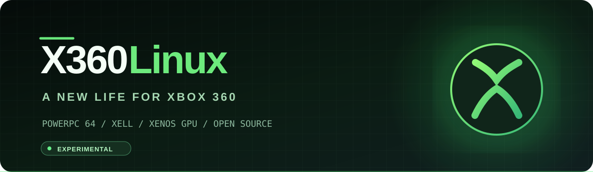

<div align="center">
  
  <h2>Native Linux research for Xbox 360 — USB first.</h2>
  <p>Experimental PowerPC Linux boot and distro development for RGH/JTAG consoles.</p>
  <p><a href="https://github.com/heltindev/X360Linux/releases/tag/v0.3.0-alpha">v0.3 download</a> · <a href="docs/V03-LEGACY-XEX.md">XEX USB guide</a> · <a href="docs/ROADMAP.md">v0.4 roadmap</a></p>
</div>

## What works on the real Xbox 360?

**Maintainer hardware report — November 8, 2026:** The legacy `default.xex` starts from an RGH Xbox 360 dashboard and reaches the Linux boot/installer experience. This verifies the XEX-to-XeLL launch path; it **does not** yet verify a complete desktop boot from USB.

| Component | Status |
| --- | --- |
| Legacy `default.xex` launched from Aurora | ✅ Confirmed by maintainer on a real RGH Xbox 360 |
| XeLL/Linux startup or installer | ✅ Reached according to maintainer's hardware test |
| Legacy `vmlinux` ELF and Ubuntu 10.10 SquashFS | ✅ File signatures and checksums verified |
| Automatic graphical desktop without installer | ⬜ Not yet demonstrated |
| Persistent Linux files on USB | ⬜ Not yet demonstrated |
| Keyboard, mouse, controller, audio, Ethernet | ⬜ Individual hardware tests pending |
| Separate X360Boot / Debian Ports shell experiments | ✅ Previous v0.2-era boot and shell testing; independent from the legacy XEX archive |

## v0.3.0-alpha — one XEX download for RGH and ABadAvatar

**[Download X360Linux v0.3 XEX USB ZIP](https://github.com/heltindev/X360Linux/releases/download/v0.3.0-alpha/X360Linux-v0.3.0-alpha-Legacy-XEX-USB.zip)** — `X360Linux-v0.3.0-alpha-Legacy-XEX-USB.zip`.

**Both methods use exactly the same Linux files** (including `default.xex`, `xell.bin`, `vmlinux`, and `casper/filesystem.squashfs`).

- **RGH/JTAG:** One FAT32 pendrive with the extracted Linux ZIP. Launch `default.xex` through Aurora. This XEX startup path was confirmed on the maintainer's real RGH console.
- **ABadAvatar:** **TWO different pendrives:** keep the ABadAvatar exploit files unchanged on USB 1 and extract **the very same Linux ZIP** onto FAT32 USB 2. When a compatible XEX launcher/dashboard is available, run `default.xex` from USB 2. ABadAvatar alone may not include an XEX launcher. This exact two-USB arrangement is not yet hardware-verified.

**No separate ABadAvatar Linux package is needed.** The older RGH/FreeMyXe ZIP attachments are unrelated historical Debian/IceWM experiments and must not be mixed with the XEX files. See the [detailed instructions](docs/V03-LEGACY-XEX.md).

The confirmed RGH test reached Linux startup/installer, **not a verified automatic USB desktop**. The latter remains a v0.4 goal. Do not install to Xbox internal HDD or flash NAND.

**Retired:** the old x360linux-local-cache release and tag have been deleted. The automatic cache upload and ISO packing workflow is disabled. Neither is needed for the tested XEX boot path.

## v0.4 — develop a real USB-native Linux distribution

Use the hardware-confirmed XEX launch route as the starting point. The planned boot sequence is **Aurora XEX → XeLL → Xenon kernel → initramfs → USB root filesystem → lightweight Linux desktop**, without a manual installer or console commands.

Target a supported **Debian Ports PowerPC 32-bit big-endian userland**, subject to Xenon kernel ABI and driver validation, and **Openbox + LXPanel + PCManFM** (not IceWM). Add persistence, keyboard/mouse, wired networking, controller pointer and audio/video in measurable hardware-tested stages, within the Xbox 360's **512 MiB RAM** budget.

**Build v0.4 locally on Windows/WSL2.** The working folder is `Desktop/PEN DRIVE/BOOT-DIRETO/v0.4-dev`, which preserves the 2011 binaries as a reference and keeps the earlier unverified Debian image unchanged. No GitHub Actions build is required for v0.4.

See [the v0.4 roadmap](docs/ROADMAP.md).

## Project layout

```text
launcher/               Original X360Boot ELF experiments (not this legacy XEX)
kernel/                 Xenon Linux kernel work
distro/                 Debian Ports and initramfs experiments
release/                Older Debian boot ZIP generation
scripts/                Build, diagnostics and local development
docs/V03-LEGACY-XEX.md  Legacy XEX boot guide, verified hashes, limitations
docs/ROADMAP.md         v0.4 direct USB Linux milestones
```

## Safety and open-source provenance

**Never flash the NAND or rename `xell.bin` as `updxell.bin` / `updflash.bin`.** The legacy Ubuntu 10.10 image is obsolete and not suitable for sensitive browsing.

The legacy 2011 files are third-party binaries supplied to the project, not built from current X360Linux source. Their exact historical sources and redistribution/license obligations still require an audit. Repository license terms do **not** relicense XeLL, Linux or Ubuntu. See [credits and licenses](docs/CREDITS.md).
