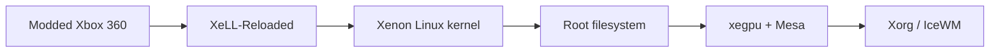

<div align="center">
  
  <br />
  <h3>Give the Xbox 360 a second life. 🐧</h3>
  <p><b>Experimental PowerPC Linux integration, XeLL boot research and Xenos GPU acceleration for modded Xbox 360 consoles.</b></p>
  <p>
    
    
    
  </p>
  <p>
    <a href="#-start-here">Start here</a> ·
    <a href="#-upstream-technology">Technology</a> ·
    <a href="#-project-status">Status</a> ·
    <a href="docs/ROADMAP.md">Roadmap</a> ·
    <a href="docs/GPU-INTEGRATION.md">GPU guide</a>
  </p>
</div>

---

> [!IMPORTANT]
> **This repository is a development integration, not a finished Linux distribution.** No X360Linux build has been verified on physical Xbox 360 hardware yet. The graphics results shown below are **credited to the upstream xenos-linux-gpu project**, not to this repository. Never flash NAND as part of this project.

## 🌱 What is X360Linux?

X360Linux connects existing Xbox 360 Linux research into one **reproducible, inspectable development workspace**. Instead of promising a magical one-click operating system, it prioritizes reliable boot, GPU bring-up, a minimal usable desktop, hardware testing and practical documentation.

| 🟢 Boot & hardware | 🧠 Linux & userspace | 🎮 Xenos graphics |
|:---|:---|:---|
| XeLL-Reloaded | Free60 Xenon kernel patches | arelyx's xegpu DRM kernel module |
| RGH/JTAG research | Linux 6.18.x starting point | Mesa freedreno Xenos variant |
| External media / TFTP | Debian ppc64 experimental rootfs | Xorg + glamor + IceWM |

### 🧩 The boot chain



This is an **architecture goal**, not a claim that this repository currently produces a bootable image.

## ⚡ Upstream technology

The independent project [**arelyx/xenos-linux-gpu**](https://github.com/arelyx/xenos-linux-gpu) reported the following on a **Trinity Xbox 360 Slim** in October 2026:

- Hardware-accelerated **OpenGL ES 2.0** and **desktop OpenGL 2.0** using Mesa freedreno with Xenos-specific patches.
- Accelerated **Xorg / glamor** and a practical **IceWM** desktop.
- **17,063 / 17,075** executed GLES2 conformance tests passed in its README's reported run.
- Demonstrations of Linux applications and some games on real hardware.

**Not yet universal or fully functional:** GPU reset after some hangs, alternative display modes, reliable 4 KB-page kernel, hardware-audited audio output, modern browser compatibility, OpenGL 2.1+ and Vulkan. See [upstream limitations](docs/GPU-INTEGRATION.md).

<div align="center">
  <a href="https://github.com/arelyx/xenos-linux-gpu/blob/main/docs/images/glamor-scanout-2026-10-26.png">
    
  </a>
  <p><sub><b>Upstream demonstration:</b> Xorg/glamor scanout captured by arelyx/xenos-linux-gpu. Not an X360Linux test screenshot.</sub></p>
</div>

## 🧪 Project status

| Workstream | Upstream evidence | X360Linux status |
|:---|:---|:---|
| XeLL boot chain | Documented by Free60 | 🟡 Reference linked |
| Xenon Linux kernel 6.18 | Free60 patch series available | 🟡 Build tooling drafted |
| xegpu kernel module | Tested on upstream Trinity | 🟡 Source linked, build not verified |
| Mesa + glamor | Upstream accelerated tests | 🟡 Instructions documented |
| Xorg + IceWM | Upstream demo | ⬜ No local hardware verification |
| Audio, network, USB, storage | Partial upstream results | ⬜ Validation pending |
| Installer / release image | — | ⬜ Not available |

Legend: 🟡 **integration preparation**, ⬜ **not verified here**. Nothing in this table means 100% compatibility.

## 🚀 Start here

**Host:** use a Linux development environment (native Linux preferred; WSL2 may help with tooling). **Console:** only an already modified Xbox 360 with a working XeLL boot/recovery method.

```bash
git clone --recurse-submodules https://github.com/heltindev/X360Linux.git
cd X360Linux
bash scripts/doctor.sh
```

Then read the [build guide](docs/BUILD.md), [GPU integration](docs/GPU-INTEGRATION.md), and the [boot-safety checklist](docs/BOOT-SAFETY.md). No script in this repository flashes NAND or installs firmware.

For GPU build experiments, have a clean **Linux 6.18.58** source tree and the Free60 `xenon-` cross-toolchain. The build scripts operate only on your disposable source tree:

```bash
bash scripts/build-kernel.sh /path/to/linux-6.18.58
bash scripts/build-xegpu.sh /path/to/linux-6.18.58
```

These are **experimental build instructions**, not a tested image pipeline. Mesa and Xorg require additional pinned dependencies and cross-compilation as described in [GPU-INTEGRATION.md](docs/GPU-INTEGRATION.md).

## 🗂 Documentation

| Document | Purpose |
|:---|:---|
| [Architecture](docs/ARCHITECTURE.md) | Console, bootloader, kernel, userspace and GPU stack |
| [Build guide](docs/BUILD.md) | Host requirements and guarded kernel/module builds |
| [GPU integration](docs/GPU-INTEGRATION.md) | Reusing xegpu, Mesa and Xorg without claiming universal support |
| [Hardware compatibility](docs/COMPATIBILITY.md) | Verified upstream results vs. our test matrix |
| [Roadmap](docs/ROADMAP.md) | Milestones required before a public release |
| [Boot safety](docs/BOOT-SAFETY.md) | Non-flashing workflow, recovery and evidence |
| [Contributing](CONTRIBUTING.md) | How to submit reproducible fixes |

## 🤝 Standing on the shoulders of Free60

This integration is made possible by [**Free60**](https://github.com/Free60Project), [**arelyx/xenos-linux-gpu**](https://github.com/arelyx/xenos-linux-gpu), the **Mesa/freedreno** and **Xorg** communities, and the original Xbox 360 homebrew researchers. Sources are integrated as **pinned Git submodules** rather than copied or relicensed. See [credits and license boundaries](docs/UPSTREAM-AND-LICENSES.md).

<div align="center">
  <sub><b>X360Linux</b> · Homebrew research for the Xbox 360 · Built in the open, tested with evidence.</sub>
</div>
